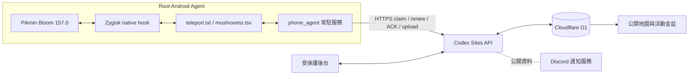

# Pikmin Mushroom Radar

Pikmin Bloom 蘑菇全球掃描、集中排程與公開地圖系統。Root Android 裝置上的 Zygisk 模組擷取遊戲地圖資料；常駐手機 Agent 依雲端派發的座標掃描，透過 HTTPS 上傳至 Codex Sites／Cloudflare D1。公開網站提供地圖、清單與活動金盆，受保護後台管理工作、裝置與輪替。

- 站台入口與管理後台網址由維運者私下提供，不在 README 公開。
- Native 建置使用本機 ASCII 路徑的乾淨工作副本；以當前環境核對 repo 與工具位置，不沿用舊電腦的固定路徑。

> [!IMPORTANT]
> 目前候選與部署基準為 **Pikmin Bloom 157.0／versionCode 1793360009、Hunter157.0-r1**。精確APK簽章、ELF／metadata與發行包雜湊見 [157候選紀錄](docs/FLEET_157_CANDIDATE_2026-11-09.md)。Native保留152–156.1獨立版本保護；網站仍接受其支援清單內的舊版成對回報，不代表每個舊版都重新完成當次實機驗收。MuMu x86_64透過NativeBridge執行ARM64遊戲，不是原生x86遊戲相容證明。

竹北先前的 156.1 三台驗收與 guest-only 備份修正記錄見 `docs/ZHUBEI_1561_VALIDATION_2026-11-06.md`；此為歷史版本驗收，不取代目前 157 文件。

## 目前狀態

開發中（尚未部署／啟用）：[台中唯一 dispatcher 的持久協調與全域批次／回程查核](docs/TAICHUNG_DISPATCH_COORDINATION_2026-10-23.md)。預設保留既有行為；正式切換與 Agent 端對端驗收仍待另行核准，不新增 scheduler。

文件審視日期：2026-11-12。架構為「Android自主Agent＋雲端逐點派工」，包含實體手機與MuMu模擬器。以下是最近的**版本驗收紀錄**，不是即時健康或在線台數：

| 群組 | 已記錄成員 | 157驗收與限制 |
| --- | --- | --- |
| 台中手機 | Aries、Cancer、Leo、Libra | 已有新非零掃描／上傳鏈；Cancer另通過自動冷啟回地圖與至少3個新非零目標 |
| 台中MuMu | Gemini、Taurus、Virgo | 三台均已安裝157/Hunter157.0-r1；11/9紀錄中Gemini仍待使用者選擇Google帳戶、維護暫停，Taurus／Virgo有非零資料；後續提示修正不等於解除登入阻擋 |
| 竹北MuMu | Aquarius、Sagittarius、Capricorn | 三台均完成至少3個不同新正式目標的native→非零TSV→上傳接受→站端ACK；Aquarius／Sagittarius保留scoped Agent2.2.14，Capricorn保留2.2.13及原刷新／冷啟政策 |

詳細證據與未完成項見 [台中157紀錄](docs/FLEET_157_VALIDATION_2026-11-09.md)、[竹北157紀錄](docs/ZHUBEI_157_VALIDATION_2026-11-09.md)。24小時耐久、全提示與自然冷啟恢復仍不得以短驗代替。Scorpio及獨立控制中心專案不列入正式掃描部署。

實體手機的日常掃描不依賴Windows、USB、ADB、固定IP或同一Wi-Fi；MuMu必須保持所屬Windows主機與instance運行。所有維修先依 [模擬器維護手冊](docs/EMULATOR_ACCESS_RUNBOOK.md) 重新核對身分與專屬通道，不能照搬跨主機instance／ADB端點或歷史PID。

- 雲端以逐點 lease 分派 target；停用、暫停、離線或 lease 逾時會安全釋放並重排。
- 正式資料僅保留等級 2–4；等級 1 在手機與雲端擷取流程中略過。
- 全域掃描預設為 **1 km 偏移網格**，每個 cycle 依四個相位改變網格原點，降低重複涵蓋。後台另提供固定 **500 m 精細模式**。
- 每日 `04:00`、`12:00`、`20:00`（Asia/Taipei）重建輪替工作，每段 8 小時。它是 request-driven：時間到後由 Agent 或後台的下一個請求觸發，並由 D1 狀態鎖保證每時段只執行一次。
- Codex Sites 提供網站與 Worker，D1 保存掃描與排程資料。Windows `scanner/` 僅保留作相容與維修用途。
- 資料清理採獨立 Cloudflare 排程、GitHub 備援與 Agent 上傳兜底；分級告警與部署／自然觸發驗收見 [INDEPENDENT_MAINTENANCE.md](docs/INDEPENDENT_MAINTENANCE.md)。獨立排程需完成帳號授權及正式驗收後才算啟用。

## 使用功能

### 公開地圖與清單

- GPS 授權：未解鎖訪客僅看清單及城市，精確座標／地圖點位不回傳。唯一管理員登入後直接顯示 GPS；其他訪客須輸入管理員設定的密碼取得 12 小時授權。更換密碼撤銷舊授權；Discord 使用獨立服務認證，不受此限制。詳見 [GPS_ACCESS.md](docs/GPS_ACCESS.md)。

- 手機友善的 Leaflet／OpenStreetMap 地圖與清單；地圖預設每 20 秒刷新，清單第一頁每分鐘更新。載入多頁時保留瀏覽位置與快照時間，可隨時按「立即刷新」回到最新第一頁。
- 等級、類型多選、國家／城市／POI／GPS 搜尋與多種排序；活動類型預設不顯示。
- 篩選仍以「活動」合併選取；清單／地圖詳情會分別顯示「萬聖節」與「輝煌」，避免跨月資料混淆。
- 預設以最新發現排序，優先且異色標示參加人數未滿 5 人的蘑菇；圖示會依等級和低人數狀態變化。
- 詳情含等級、類型、國家－城市、POI、GPS、參加人數／上限、總戰力、挑戰起訖、剩餘時間、更新時間與發現 Agent 名稱。
- 可複製 GPS 或精簡資訊、開啟 Google 地圖。前端採 viewport bbox + cursor pagination，避免資料量增加後拖慢地圖。

### 活動金盆

`/event-spots`（亦可使用 `/event-spots.html`）與蘑菇掃描分離，提供可追溯的常設／限時活動資源點：

- 顯示活動期間、獎勵、資格、限制、座標說明及來源 URL。
- 可依國家、有效狀態或關鍵字篩選；只有有效數值座標才提供GPS複製與地圖定位。
- 官方與社群座標明確區分，並保留驗證日期與座標精度註記，避免把概略位置當成官方精確點位。
- `site/lib/event-spots.ts` 是已定位資源點；`site/public/event-spot-notices.json` 保存官方活動已公布但精確GPS待確認的卡片。卡片不產生地圖標記，也不會把null轉成0,0。
- 11/12更新後為57個座標點與4張待座標卡，包含既有紐約／舊金山宇宙船活動。韓國蠶室與釜山兩筆僅為場館導航參考，尚未遊戲複核；新加坡兩場、巴黎香榭麗舍及荷蘭動漫展的精確GPS待確認。這是目錄數量，啟用有效日期篩選後顯示筆數會不同。

### 雲端管理後台

- 建立國家城市包或自訂 GPS 範圍的單輪／循環工作。
- 查看工作、目前城市、點位、擷取數、log、fleet health、連續無資料告警、每點耗時與 24 小時 soak report。
- 暫停、恢復、停用或啟用 Agent；停用時立即釋放 lease。
- 建立獨立 Agent 憑證、查看 Agent／遊戲／module 版本、換發及撤銷 token。
- 發報前可優先派工複查候選點，完成後自動回到原工作。

### 國家城市包與每日輪替

2026-11-03：自動城市包先用固定版本 OSM 陸地遮罩排除外海，再依有效取樣點數平衡所有機隊大小的路線。新增納米比亞、波札那、賴索托、史瓦帝尼、辛巴威、尚比亞、莫三比克，南非擴為六城；每日共 77 包／443 城。沿海採保守篩選，不保證排除所有內陸水域；新城市須先產生遮罩。詳見 [全局陸地分區與部署規則](docs/GLOBAL_LAND_REGIONS.md)。


完整 catalog 位於 `site/lib/scan-plans.ts`，自動輪替規則位於 `site/lib/rotation-plan.mjs`。

- 04:00 掃亞洲／大洋洲，12:00 掃歐洲／中東／非洲，20:00 掃北美／中美／南美；每個城市包在規定時段必須已進入當地當日 01:00 以後。
- 保留各Agent時段資格；12:00輪替的柏林取樣權重為3倍，詳見 [柏林權重規則](docs/BERLIN_WEIGHT_2026-10-23.md)。
- **台灣與日本不納入自動輪替。** 既有 catalog 僅供歷史／必要時的手動管理，並非每日排程來源。
- 同時段各路線互不重疊；每日更換 Agent 與路線對應。依當時可派工 Agent 數重新均分同時段全部城市包，保留全部地區涵蓋；上限為十二個同時啟用Agent，不是歷史註冊總數，超過亞洲國家包數時以獨立lease共用國家包。定時任務按時段容量對每城取樣並於循環時偏移，不把完整8km網格一次排進短時段。
- Agent 名單改變、手動重排或排程換區前，先等待正式情報複查與回程驗收完成；之後系統會停止舊工作、使舊 lease 失效並新建循環工作，避免舊區域回傳污染新工作。

## 架構



### Android

1. `module/` Zygisk 模組注入遊戲，讀取蘑菇欄位並使用遊戲內定位覆寫流程。
2. target 寫至 `teleport.txt`，擷取結果累積寫入 `mushrooms.tsv`。
3. `phone_agent/agent.sh` claim、續租、等待 map refresh、增量上傳 TSV、ACK，並處理 pause／stop／復原。
4. `service.sh` 開機後啟動 Agent；Magisk action 可做受限時長冷重啟與程序檢查。
5. 正式掃描使用Android主顯示畫面（`LOCAL_DISPLAY=0`；MuMu為guest主顯示）。專用virtual display是另行驗證的選項，未宣稱遊戲切背景或關閉渲染後仍可等效掃描。

### 雲端與 Windows

- `site/` 包含 Vinext／React、Cloudflare Worker、D1 migration 與測試；Agent v2 API 支援逐點派工、續租、ACK、TSV upload 與 fleet metrics。
- 公開 `/api/mushrooms` 會輸出未過期資料、粗粒度進度及發現 Agent 的顯示名稱；不輸出 token、裝置定位、target／lease、裝置版本或內部計數器。
- Windows用於開發、native build、首次安裝、升級、維修，並承載MuMu節點；舊 `scanner/` 不是雲端自主Agent的必要元件。

## 專案結構

| 路徑 | 用途 |
| --- | --- |
| `module/cpp/` | Pikmin 152–157 獨立簽章保護、Zygisk hook、定位與 TSV 寫入原始碼 |
| `module/build-dual-abi.ps1` | Android NDK ARM64／x86_64 建置 |
| `module/package-module.ps1` | Magisk ZIP 建立與路徑驗證 |
| `phone_agent/` | Android Agent、開機服務、復原與 virtual display 工具 |
| `agent_control_app/` | 手機端 GPS／城市／掃描結果與暫停控制 App |
| `agent_gps_bridge/` | Android9逐點系統定位輔助，無網路權限；不負責派工 |
| `site/` | 網站、活動金盆、後台、API、D1 schema／migration／測試 |
| `maintenance-worker/` | 獨立Cloudflare資料清理入口；啟用須另有正式驗收 |
| `tools/` | 身分綁定的唯讀模擬器通道健檢等維修工具 |
| `scanner/` | 舊 Windows 掃描器與維修工具 |
| `reference/` | 本機 IL2CPP 逆向參考資料；大型 dump 不納入 Git |
| `SPEC_*.md` | Native、顯示、supervisor、fleet 的詳細規格與歷史 |

## 開發、測試與部署

### 網站

需求：Node.js `>= 22.13.0`、npm，及正式部署用 Codex Sites／D1 權限。

```powershell
# 從目前 repo 根目錄執行
Set-Location .\site
Copy-Item .env.example .env.local  # 僅首次建立；已有設定不覆蓋
npm ci
npm run dev
# 驗證時另執行；npm test包含完整build及Node測試
npm test
```

`.env.local` 只在本機保存必要資料，絕不可提交。後台唯一帳號為 Sites 認證的 `ody.liao@gmail.com`；舊 `ADMIN_EMAILS` 不再擴增權限。`AGENT_TOKEN`、`CONTROLLER_TOKEN` 僅為相容／維修與服務查詢，新 Agent 均用個別 token 雜湊保存。

網站結構、D1與安全標頭修改方式見 [site/README.md](site/README.md)。CI另有lint、production lockfile audit及Android shell／probe測試，實際命令以 `.github/workflows/security-ci.yml` 為準；Node測試成功不代表實機或24h驗收成功。

### Native 模組

需求：Windows PowerShell、Android NDK r27d、CMake、Ninja、Google Platform-Tools、已 root 並啟用 Magisk／Zygisk 的 Android，以及精確的 157.0／1793360009 遊戲 build。建置前核對當前工作副本與工具路徑；舊電腦的固定路徑不是新環境已具備工具的證據。

```powershell
# 從目前乾淨 repo 根目錄執行
powershell.exe -NoProfile -ExecutionPolicy Bypass -File .\module\build-dual-abi.ps1
powershell.exe -NoProfile -ExecutionPolicy Bypass -File .\module\package-module.ps1 -GameVersion 157.0 -GameVersionCode 1793360009 -ModuleRevision r1
```

請勿用 Windows `Compress-Archive` 自製 Magisk ZIP；一律使用專案 packaging script，確保 ZIP 內 `zygisk/` 路徑正確。腳本的歷史預設仍為152，不能省略版本參數。

156.0-r2 在 `libnb.so` NativeBridge 載入 ARM64 payload 前等待 30 秒，
保留其他 bridge 原有 5 秒等待。Gemini 的冷啟動對照顯示，只延後後續掃描
掛鉤不足以恢復登入；需在轉譯載入前留出初始化時間。實體 ARM64 不走此路徑，
游戲版本、簽章檢查及認證流程保持。仍須完成同 PID 的實際掃描及重開驗收。

### Agent 安裝／升級

> [!CAUTION]
> 方案需要 root、Magisk、Zygisk，並會讀取遊戲私有檔案、注入遊戲程序和覆寫定位。請自行評估遊戲服務條款、帳號與裝置風險。

1. 確認實際 ABI、Magisk／Zygisk、遊戲版本 **157.0／1793360009**、APK 簽章及對應 native 指紋。
2. 任何變更前先驗證guest／裝置內root-only完整備份；在無未決ACK且已上傳的安全邊界停止唯一原Agent。
3. 就地更新已驗證的遊戲與Hunter；安裝 `module/pikmin_hunter.zip` 或更新native `.so` 後必須重啟該Android裝置／guest，不重啟整台Windows主機。
4. 僅新節點需在後台建立獨立Agent，將一次性ID／token寫入裝置私有config／token。既有節點保留原身分、帳戶、憑證與地區資格，不重建節點。
5. 以scoped更新保留原上傳程式、config、token、TSV、offset及pending狀態，不整包覆蓋別機配置。shell檔權限為 `0700`；保持 `LOCAL_DISPLAY=0`，Android9 GPS bridge另依該元件README及已驗證配置處理。
6. 重啟後核對載入雜湊及唯一Agent，完成至少3個不同新正式target的native object、非零TSV、接受上傳及站端ACK，再回原工作。

日常掃描不需要ADB連線。首次安裝／維修使用當地主機已確認的工具與受限通道；不執行共用ADB server重啟或任意root/unroot，避免中斷其他Agent。詳細步驟見 [phone_agent/README.md](phone_agent/README.md)。

### Sites／D1

GitHub main是唯一開發來源，Sites是正式發布鏡像；流程為feature branch → PR → checks → merge。發布依 [RELEASE_GATES.md](docs/RELEASE_GATES.md) 及當次Sites工具流程，先核對現有project、正式版本與來源差異，再準備精確site來源、短效credential與build archive，部署至 `succeeded` 並驗證公開路由及授權後台。不得直接以舊交接文件的固定路徑或Git分支覆蓋當前工作。純README（包括 `site/README.md`）變更不需重部署；GitHub合併與網站發布是兩個獨立結果。

Native 或 Agent 變更必須完成實機端到端驗證：版本簽章、hook log、目標城市、TSV、upload、ACK 缺一不可。

## Agent 流程與 API

1. Agent 以 Bearer token 與 `X-Agent-Id` 呼叫 `/api/agent/v2/task`。
2. 雲端依 Agent 可用區域與現行 job 核發有期限 lease。
3. Agent 寫入 target、等待 native refresh marker、上傳新 TSV row，並經 control 續租。
4. 成功後以 lease token ACK；pause、stop、失聯和過期 lease 不會被視為成功。
5. 循環工作完成後以新 cycle 重建偏移網格；非循環工作則結束。

| 路由 | 權限 | 用途 |
| --- | --- | --- |
| `GET /api/mushrooms` | 公開清單／授權 GPS | 未過期蘑菇；精確 `bbox`／GPS 限管理員、密碼授權或控制器 |
| `GET /api/event-spots` | 公開 | 活動金盆資料與有效狀態篩選 |
| `GET /api/admin/metrics?hours=24` | 管理者 | fleet health 與 soak report |
| `/api/admin/scans/**` | 管理者 | 建立、查看、暫停、恢復、停止工作 |
| `/api/admin/agents/**` | 管理者 | Agent 設定、狀態與 token rotation |
| `/api/agent/v2/task`、`/control`、`/ack` | Agent | claim、續租／控制、回報結果 |
| `/api/agent/upload` | Agent | 增量 UTF-8 TSV upload |

`mushrooms.tsv` 是累積檔；新增量必須以新 row／蘑菇 ID 判斷，不能以檔案總行數推論。上傳端對 body、row 數與欄位做邊界檢查及正規化。

Agent2.2.14以同一個完整換行TSV前綴計算rows／bytes，接受上傳游標涵蓋該前綴後才送成功ACK。`receipt-v1` 則是另行opt-in的重送去重協定（`UPLOAD_RECEIPTS_ENABLED=0`預設停用）；不能把站端支援說成全部Agent已啟用，見 [UPLOAD_RECEIPTS.md](docs/UPLOAD_RECEIPTS.md)。

公開蘑菇 API 所有請求均分頁（預設 500、每頁最多 1,000 筆）；完整結果須沿 `next_cursor` 讀到結束，並非總數上限。網頁可使用 15 秒短快取，Discord 原有查詢維持不快取。分頁相容性、限流與觀測方式見 [公開查詢效能說明](docs/PUBLIC_MAP_EFFICIENCY.md)。

## 安全與維運

- `/admin` 限 Sites 認證的唯一管理員；GPS 密碼寫入需明確同來源 JSON 請求，密碼雜湊與授權由伺服器驗證。
- 每台 Agent 使用獨立 token，伺服器只保存雜湊；rotation 有受限過渡期，可立即撤銷。
- 公開 API 不回傳 token、精確裝置位置、target／lease、版本或內部計數器。發現 Agent 名稱只代表資料出處，不代表即時位置。
- 站點啟用 HSTS、CSP、`nosniff`、frame denial、referrer 與 permissions policy；上傳採 bounded UTF-8 parsing。
- `.env*`、token、DB／log、dump、部署包與裝置 metadata 均須 Git ignore。public repo、PR、Issue、截圖與交接文件不得出現任何憑證。
- token 疑似外洩時，立即停用 Agent、釋放 lease、換發憑證並只更新該裝置；詳見 `SECURITY.md`。

## 外部通知與限制

Discord 通知服務是獨立 repo／獨立排程，使用控制器認證查詢完整蘑菇資料，發送即時批次、定期情報與營運摘要；通知規則、複查、去重、排程及 webhook 需在該服務維護，不能混入本 repo。

- Native hook 與遊戲版本強綁；版本變更要重新 dump、定位 RVA／簽章並實機驗證。
- 未 root、未裝 Magisk／Zygisk 的裝置或模擬器不能直接成為同等 Agent。
- secure surface 可能讓截圖黑畫面；應以 hook／Agent log、TSV、upload、ACK 驗證。
- 快速跨區移動可能觸發遊戲提示或冷卻；縮短 dwell／加大跳點要先以單一 Agent A/B 實驗。

## 文件索引與後續方向

1. `README.md`：正式架構、現況與日常入口。
2. `SECURITY.md`：信任邊界、secret、事件處置。
3. `SPEC_autoscan.md`：hook、欄位偏移、native build／deploy 歷史與 gotchas。
4. `phone_agent/README.md`：Agent 協定、設定與更新。
5. `SPEC_ON_DEVICE_DISPLAY.md`、`SPEC_GLOBAL_FLEET.md`：顯示與 fleet 設計。
6. `docs/RELEASE_GATES.md`、`docs/EMULATOR_ACCESS_RUNBOOK.md`：現行發布及通道維護入口；`CLAUDE_HANDOFF.md`、`CLAUDE_SITES_DEPLOY_HANDOFF_2026-08-20.md` 是歷史交接，須重新核對版本、路徑與權限。
7. `WORKLOG.md`、`DEV_HISTORY.md`、`DESIGN_autoscan.md`、`HOOK_TARGETS.md`：歷史決策與除錯。

後續待驗：157長時間耐久與自然冷啟恢復、逐機提示覆蓋、receipt-v1實機canary及配置推廣。allocation shadow與dispatcher協調的未啟用功能，須各自完成文件規定的觀測與核准；活動金盆持續依可追溯來源補充，場館參考與精確遊戲GPS分開標示。

本專案是非官方研究與個人維運工具，與 Niantic 或 Nintendo 無關。
